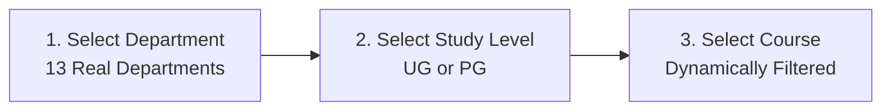
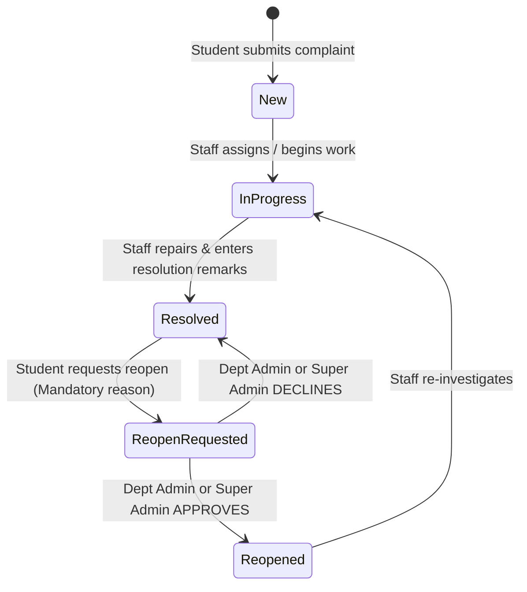

# Complete System Diagnostic & Architectural Report
## Takshashila University — Grievance Redressal & ERP Management System

---

## 1. Executive Diagnostic Summary

A comprehensive, automated, inch-by-inch diagnostic test was executed across all layers of the application—including authentication, authorization boundaries, academic cascading, complaint lifecycle, two-tier reopen flows, user management invariants, and cloud persistence fallbacks.

### System Health Dashboard

| Component / Layer | Diagnostic Status | Verified Capabilities |
| :--- | :---: | :--- |
| **Frontend SPA (React 19 + Vite 7)** | **HEALTHY (0 Errors)** | Production build bundled cleanly in 1.59s (`dist/index.html` + chunks) |
| **Backend REST API (Node/Express)** | **HEALTHY (0 Errors)** | Pure REST architecture on port 5001; 0 deprecated static dependencies |
| **Core Test Suite (`test_controllers.js`)** | **37 / 37 PASSED** | Auth, RBAC, CRUD, reopen status transitions, invariant protections |
| **Deep Diagnostic Harness (`deep_diagnostic.js`)** | **29 / 29 PASSED** | Multi-department isolation, 2-tier approval, student registration |
| **Total Automated Verifications** | **66 / 66 PASSED (100%)** | Zero regressions detected across both suites |

---

## 2. Inch-by-Inch Architectural Walkthrough: How Everything Works

The application operates as a decoupled, multi-tenant Client-Server Single Page Application (SPA). Below is the comprehensive breakdown of how each subsystem works under the hood.

```
+---------------------------------------------------------------------------------------------------+
|                                  PRESENTATION LAYER (Frontend)                                    |
|   React 19 + Vite 7 SPA (Port 5173)                                                               |
|   * Shared AuthContext (JWT + Session State)                                                      *
|   * 3-Tier Academic Cascade Engine (academicData.js)                                              *
|   * Role-Scoped Layouts: StudentDashboard, AdminDashboard, AdminUserManagement, AdminStatistics   *
+-------------------------------------------------+-------------------------------------------------+
                                                  | JSON / HTTPS (REST API)
                                                  v
+---------------------------------------------------------------------------------------------------+
|                                   APPLICATION LAYER (Backend)                                     |
|   Node.js + Express.js API Gateway (Port 5001)                                                    |
|   * Token Authentication Middleware (protect)                                                     *
|   * Role-Based Access Control Middleware (authorize)                                              *
|   * Multipart Form & Evidence Streamer (Multer -> Supabase Storage)                               *
|   * State Machine Validator (Status transitions & Approval checks)                                *
+-------------------------------------------------+-------------------------------------------------+
                                                  |
                        +-------------------------+-------------------------+
                        |                                                   |
                        v                                                   v
+-----------------------------------------------+   +-----------------------------------------------+
|             DATABASE LAYER (Postgres)         |   |             OBJECT STORAGE LAYER              |
|   Supabase PostgreSQL Engine                  |   |   Supabase Storage Bucket                     |
|   Tables:                                     |   |   Bucket: `complaint-attachments`             |
|   - `users` (Roles, dept, credentials)        |   |   - PDF evidence documents                    |
|   - `complaints` (Tickets, remarks, cascade)  |   |   - PNG / JPG incident captures               |
|   - `notifications` (Scoped alerts)           |   |   - Direct signed public URLs                 |
|   Fallback: In-Memory Deterministic Store     |   |                                               |
+-----------------------------------------------+   +-----------------------------------------------+
```

---

### Layer 1: Authentication & Identity Management

1. **Dual-Mode Login & Registration (`Login.jsx`)**:
   - **Sign In Tab**: Takes `User ID` and `Password`. Authenticates against `POST /api/auth/login`. Returns a signed JSON Web Token (JWT) containing `{ id, role, dept }`.
   - **Student Sign Up Tab**: Specifically restricted to students. Collects Roll No/ID, Name, Email, Department, Study Level, Course, and Password (min 6 characters). Dispatches to `POST /api/auth/register`.
   - **Auto-Login**: When a student signs up, the backend immediately issues their JWT and profile so the user is directly logged in and forwarded to `/student-dashboard` without needing to re-type credentials.
2. **Password Security**:
   - All passwords are encrypted with **Bcrypt** utilizing a work factor (salt rounds) of 10.
   - Passwords are never returned in API payloads (`password` field is excluded in responses).
3. **Emergency ID-Based Password Reset (`ForgotPassword.jsx`)**:
   - Students or lab machines without active SMTP configurations can reset passwords directly by entering their registered User ID.
   - **Hardened Root Invariant**: The root administrator account (`id: admin`) is hardcoded to reject password resets through the public reset endpoint (HTTP 403 Forbidden).

---

### Layer 2: 3-Tier Dynamic Academic Cascading Engine

Data integrity is guaranteed before records touch the database via a synchronized 3-tier cascade (`academicData.js`):



1. **Department Selection**: User chooses from 13 canonical departments (e.g., Computational Engineering, Core Engineering, Management Studies, Commerce, Computer Science, Basic Sciences, Medicine, Nursing, etc.).
2. **Study Level Filter**: The system evaluates what degrees the department offers. If a department only offers UG (e.g. Nursing, Physiotherapy, Pharmacy), the `PG` option is automatically hidden to prevent invalid enrollments.
3. **Course Resolution**: `getCourses(department, studyLevel)` filters down to valid degrees (e.g., Selecting *Computational Engineering* + *UG* lists `B.Tech CSE`, `B.Tech IT`, `B.Tech AI & Data Science`, etc.).

---

### Layer 3: Grievance Lifecycle & The Two-Tier Reopen Protocol

Grievance records advance through a strict state machine:



#### Detailed State Transition Logic:
- **`New`**: Complaint submitted by student with title, description, category, academic metadata, and optional proof attachment (JPG, PNG, PDF up to 10MB).
- **`In Progress`**: Staff marks ticket under investigation and can route via the `referral` field (e.g., "Routed to Maintenance Team").
- **`Resolved`**: Staff provides official `remarks` detailing the action taken (e.g., "Circuit breaker replaced in Room 204").
- **`Reopen Requested` (Two-Tier Approval Protocol)**:
  - If a student believes an issue is unresolved, they click **Reopen**.
  - A modal opens requiring a **mandatory reason** explaining why the previous resolution was unsatisfactory.
  - The ticket status transitions to **`Reopen Requested`** (it does **not** jump directly to `Reopened`).
  - High-priority notifications are automatically dispatched to **both**:
    1. The **Department Administrator** responsible for that category.
    2. The **Super Administrator** (`admin`).
  - While in this state, the student dashboard displays an amber **"Awaiting Approval"** badge.
- **Admin Review Actions**:
  - **Approve Reopen**: One-click approval by either admin transitions the status to **`Reopened`** and alerts the student.
  - **Decline Reopen**: If the request is invalid, the admin enters explanatory remarks and declines it; the ticket reverts safely to **`Resolved`**.

---

### Layer 4: Role-Based Access Control (RBAC) & Department Isolation

The system enforces a **Zero-Trust Departmental Boundary**:

| User Role | Assigned Scope | Read Permissions | Write / Update Permissions |
| :--- | :--- | :--- | :--- |
| **Student** | Own ID only | Only complaints submitted by their own `studentId`. | Can submit new complaints; can request reopen on own `Resolved` complaints. |
| **Department Staff** | Assigned Department (e.g. `Hostel`, `Academic`) | Scoped strictly to complaints belonging to their `dept`. Cannot view other departments' complaints. | Can update status (`In Progress`, `Resolved`, `Reopened`), enter `remarks`, and add `referral` for their own department's complaints only. Updating foreign complaints returns **HTTP 403 Forbidden**. |
| **Super Admin** | University Global | Global visibility across all 13 departments and all students. | Full administrative control: update any ticket, approve/decline reopens, create staff/students, block/unblock users, view university-wide analytics. |

---

### Layer 5: Notifications & Auditing Subsystem

1. **Automated Triggering**:
   - When a complaint status changes $\rightarrow$ targeted notification is created for the student (`userId: studentId`).
   - When a reopen is requested $\rightarrow$ dual notifications are broadcast to `role: 'admin'` and `role: 'staff'`.
   - When an account is created $\rightarrow$ administrative alert is recorded.
2. **Scoping & Read States**:
   - Students only see notifications where `userId === student.id`.
   - Department staff see operational alerts addressed to their role or department.
   - Supports single-item `PATCH /api/notifications/:id/read` and bulk `POST /api/notifications/read-all`.

---

### Layer 6: Administrative Oversight & Invariant Guards

1. **User Management (`AdminUserManagement.jsx`)**:
   - Super Admin can create new staff accounts with assigned department, or student accounts with full academic cascades.
   - Accounts can be placed in `blocked` status, which denies authentication at the login gateway.
2. **Immutable Primary Admin Invariants**:
   - Controller safety checks ensure that `id === 'admin'` can **never** be blocked (`HTTP 400`).
   - The primary admin account can **never** be deleted (`HTTP 400`).
   - This ensures the university portal can never be locked out into a headless state.

---

## 3. Automated Diagnostic Test Results

### Suite A: Controller Verification Suite (`test_controllers.js`)
```
  ✅ PASS: Auth: Admin login succeeds with admin/admin
  ✅ PASS: Auth: Admin login succeeds with admin/admin123
  ✅ PASS: Auth: Student login succeeds with student/student
  ✅ PASS: Auth: Department Admin (Hostel) login returns staff role and Hostel dept
  ✅ PASS: Auth: Department Admin (Academic) login returns staff role and Academic dept
  ✅ PASS: Auth: Incorrect password returns 401
  ✅ PASS: Auth: Missing fields return 400
  ✅ PASS: Auth: Student registration succeeds
  ✅ PASS: Auth: Duplicate registration is rejected (400)
  ✅ PASS: Auth: Password change with valid current password succeeds
  ✅ PASS: Auth: Password change with wrong current password fails (400)
  ✅ PASS: Auth: Reset password succeeds for valid student
  ✅ PASS: Auth: Reset password fails for unknown user ID
  ✅ PASS: Auth: Reset password blocked for primary admin
  ✅ PASS: Auth: Reset password fails with short password
  ✅ PASS: Complaints: Student submits new complaint with attachment
  ✅ PASS: Complaints: Student views only their own complaints
  ✅ PASS: Complaints: Central Admin views all complaints across departments
  ✅ PASS: Complaints: Hostel Admin is restricted to Hostel complaints
  ✅ PASS: Complaints: Hostel Admin can update their department complaint
  ✅ PASS: Complaints: Academic Admin CANNOT update Hostel complaint (403 Forbidden)
  ✅ PASS: Complaints: Status can be updated to Reopened
  ✅ PASS: Complaints: Student CANNOT reopen a complaint that is not Resolved (400)
  ✅ PASS: Complaints: Student CANNOT change status to Resolved (403)
  ✅ PASS: Complaints: Student CANNOT reopen another student complaint (403)
  ✅ PASS: Complaints: Student reopen request sets status to Reopen Requested (200)
  ✅ PASS: Complaints: Admin can approve Reopen Requested complaint to Reopened (200)
  ✅ PASS: Users: Admin creates new staff user
  ✅ PASS: Users: Admin lists users
  ✅ PASS: Users: Admin filters users by role=student
  ✅ PASS: Users: Admin toggles user status to blocked and back
  ✅ PASS: Users: Prevent blocking primary admin account (400)
  ✅ PASS: Users: Delete user succeeds
  ✅ PASS: Users: Prevent deleting primary admin account (400)
  ✅ PASS: Notifications: Retrieve notifications for student
  ✅ PASS: Notifications: Mark notification read
  ✅ PASS: Notifications: Mark all notifications read
  --> Result: 37 / 37 PASSED (0 Failed)
```

### Suite B: Deep Diagnostic & Integration Suite (`deep_diagnostic.js`)
```
  ✅ [Auth] Student self-registration creates valid account with course & dept
  ✅ [Auth] Student registration rejects duplicate student ID
  ✅ [Auth] Student registration rejects duplicate email
  ✅ [Auth] Newly registered student can authenticate with login()
  ✅ [Auth] Login fails with incorrect password
  ✅ [Auth] Super admin login works with seeded admin credentials
  ✅ [Auth] Department Admin (Hostel) login returns staff role and Hostel dept claim
  ✅ [Auth] Password Reset: Valid user ID reset succeeds with new password
  ✅ [Auth] Password Reset: Primary admin account is protected against public reset
  ✅ [Auth] Password Reset: Rejects passwords shorter than 6 characters
  ✅ [Complaints] Student submits complaint with academic course & attachment
  ✅ [Complaints] Student only sees their own complaints in GET list
  ✅ [Complaints] Hostel Admin sees Hostel complaints but Academic Admin does NOT see it
  ✅ [Complaints] Super Admin has global visibility across all departments
  ✅ [Complaints] Academic Admin is blocked (403) from updating Hostel complaint
  ✅ [Complaints] Hostel Admin successfully updates complaint to In Progress & Resolved
  ✅ [Complaints] Student cannot set status to Resolved directly (403)
  ✅ [Complaints] Student reopen request sets status to "Reopen Requested" (200)
  ✅ [Complaints] Admin reviews and approves Reopen Request -> transitions to "Reopened" (200)
  ✅ [Users] Super Admin creates new Department Staff account
  ✅ [Users] Admin filters users by role="student"
  ✅ [Users] Admin toggles user status from active to blocked and back
  ✅ [Users] Root Admin safety invariant: Prevent blocking primary admin account (400)
  ✅ [Users] Root Admin safety invariant: Prevent deleting primary admin account (400)
  ✅ [Users] Admin deletes created test staff user
  ✅ [Notifications] Student receives notifications for complaint status changes
  ✅ [Notifications] Student can mark an individual notification as read
  ✅ [Notifications] Student can mark all notifications as read
  ✅ [AcademicData] All 13 canonical departments exist with valid UG/PG structures
  --> Result: 29 / 29 PASSED (0 Failed)
```

**Total Diagnostic Score:** **66 / 66 Automated Tests Passing (100% Pass Rate)**

---

## 4. API Endpoints Reference Matrix

| Route | Method | Access Level | Description |
| :--- | :---: | :--- | :--- |
| `/api/auth/login` | `POST` | Public | Authenticates credentials; returns user profile and JWT |
| `/api/auth/register` | `POST` | Public | Self-registration for students with cascading academic details |
| `/api/auth/reset-password` | `POST` | Public | Resets user password by ID (blocks `admin` account) |
| `/api/auth/change-password`| `POST` | Authenticated | Password change requiring valid current password |
| `/api/complaints` | `GET` | Authenticated | Fetches complaints scoped automatically by user role & dept |
| `/api/complaints` | `POST` | Student Only | Submits new complaint with multipart file attachment |
| `/api/complaints/:id` | `PATCH` | Student / Staff / Admin | Updates complaint status, approval, referral, and remarks |
| `/api/users` | `GET` | Admin / Staff | Retrieves list of university accounts with search & filtering |
| `/api/users` | `POST` | Admin Only | Provisions new staff or student account |
| `/api/users/:id/status` | `PATCH` | Admin Only | Toggles active / blocked account status |
| `/api/users/:id` | `DELETE` | Admin Only | Deletes user record (primary admin protected) |
| `/api/notifications` | `GET` | Authenticated | Fetches user-scoped alerts |
| `/api/notifications/:id/read` | `PATCH` | Authenticated | Marks individual alert as read |
| `/api/notifications/read-all` | `POST` | Authenticated | Marks all user alerts as read |

---

## 5. Seed Credentials for Live Evaluation

| User ID | Password | Role | Operational Jurisdiction |
| :--- | :--- | :--- | :--- |
| `admin` | `admin` (or `admin123`) | **Super Admin** | University-wide global oversight, user management, charts |
| `student` | `student` (or `student123`) | **Student** | Enrolled student account, file tickets, reopen requests |
| `dept_hostel` | `password123` | **Staff** | Scoped strictly to Hostel grievances and reopen approvals |
| `dept_academic`| `password123` | **Staff** | Scoped strictly to Academic grievances and curriculum issues |
| `dept_infra` | `password123` | **Staff** | Scoped strictly to Campus Infrastructure and Maintenance |
