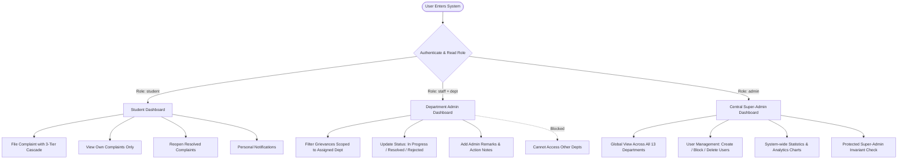

# Project Review & Viva Examination Document
## Takshashila University — Grievance Redressal & Complaint Management System

---

## 1. Executive Summary

### 1.1 Project Title
**Takshashila University Grievance Redressal & Complaint Management Portal**

### 1.2 Problem Statement
Traditional university complaint handling systems rely heavily on manual paper submissions, informal verbal reporting, and unstructured email chains. This causes:
- **Lack of Transparency & Traceability:** Students cannot track the resolution lifecycle of their grievances.
- **Accountability Deficits:** Complaints are often misplaced, delayed, or lack an audit trail of which authority was assigned.
- **Privacy & Security Risks:** Sensitive student issues (hostel, discipline, academics) are exposed across non-confidential channels.
- **Administrative Overhead:** Central administrators are overwhelmed by lack of departmental categorization, duplicate submissions, and missing diagnostic evidence.

### 1.3 Proposed Solution
A modern, responsive, multi-role web application built with **React 19 (Vite)** on the frontend, **Node.js/Express.js REST APIs** on the backend, and **Supabase (PostgreSQL + Cloud Storage)** with local in-memory fallback. The system automates grievance submission, departmental dispatch, status tracking, evidence attachment, notifications, and analytics with strict **Role-Based Access Control (RBAC)**.

---

## 2. System Architecture & Tech Stack

```
+--------------------------------------------------------------------------+
|                        PRESENTATION LAYER (Frontend)                     |
|  React 19 (Vite) + Tailwind CSS + Lucide Icons + Chart.js (Analytics)     |
+------------------------------------+-------------------------------------+
                                     |  JSON / HTTPS REST API
                                     v
+--------------------------------------------------------------------------+
|                         APPLICATION LAYER (Backend)                      |
|  Node.js + Express.js API Gateway                                        |
|  * JWT Auth & Role Scoping Middleware                                    |
|  * Multer Multipart Attachment Handler                                   |
|  * Bcrypt Password Hashing & Direct ID Reset Service                     |
+------------------------------------+-------------------------------------+
                                     |
              +----------------------+----------------------+
              |                                             |
              v                                             v
+-----------------------------+               +-----------------------------+
|    PERSISTENCE LAYER (DB)   |               |     CLOUD STORAGE LAYER     |
|  Supabase (PostgreSQL)      |               |  Supabase Storage Bucket    |
|  Tables:                    |               |  `complaint-attachments`    |
|  - users                    |               |                             |
|  - complaints               |               |  * PDF, JPG, PNG Proofs     |
|  - notifications            |               |  * Secure Public URL Gen    |
+-----------------------------+               +-----------------------------+
```

### 2.1 Technology Stack Details
| Layer | Technology | Key Capabilities & Purpose |
| :--- | :--- | :--- |
| **Frontend Framework** | **React 19 + Vite 7** | Fast SPA rendering, component modularity, instant HMR |
| **Styling & Icons** | **Tailwind CSS + Lucide-React** | Clean enterprise design, consistent design tokens, accessibility |
| **Data Visualization** | **Chart.js + React-Chartjs-2** | Visual grievance trends, status breakdown & departmental analytics |
| **Backend Runtime** | **Node.js (v18+) & Express.js** | Non-blocking asynchronous REST API micro-services |
| **Authentication** | **JWT + Bcrypt.js** | Secure salted password hashing, stateless token authorization |
| **Database** | **Supabase (PostgreSQL engine)** | Relational schemas, ACID compliance, structured indexing |
| **File Storage** | **Supabase Cloud Storage** | Dedicated `complaint-attachments` bucket for evidence files |
| **Fallback Engine** | **Deterministic Local In-Memory Store** | Zero-downtime offline testing and fallback if offline |

---

## 3. User Roles & Access Control Matrix (RBAC)

The system enforces strict multi-tenant authorization rules across three distinct actors:



### RBAC Permission Matrix

| Operation / Feature | Student | Department Staff | Central Admin |
| :--- | :---: | :---: | :---: |
| Submit New Complaint | ✅ Yes | ❌ No | ❌ No |
| View Personal Complaints | ✅ Yes (Own only) | ❌ No | ✅ Yes (Global) |
| View Department Complaints | ❌ No | ✅ Yes (Scoped) | ✅ Yes (Global) |
| Change Status (In Progress/Resolved/Rejected) | ❌ No | ✅ Yes (Own Dept) | ✅ Yes (Global) |
| Reopen Complaint | ✅ Yes (Only if Resolved) | ❌ No | ❌ No |
| Add Admin Resolution Remarks | ❌ No | ✅ Yes | ✅ Yes |
| Create New Student/Staff Users | ❌ No | ❌ No | ✅ Yes |
| Block/Delete Users | ❌ No | ❌ No | ✅ Yes |
| View University Analytics Charts | ❌ No | ❌ No | ✅ Yes |

---

## 4. Key Innovations & Distinctive Features

### 4.1 Three-Tier Dynamic Academic Cascade
To prevent invalid submissions and misrouted complaints, the portal features a synchronized cascading selector:
1. **Department Selection:** (13 Real-world Departments including Computational Engineering, Core Engineering, Management Studies, Commerce, Computer Science, Basic Sciences, Medicine, Nursing, etc.).
2. **Study Level Selection:** Dynamically shows `UG` and/or `PG` based on what the selected department actually offers (e.g., Nursing and Pharmacy strictly provide UG, suppressing empty PG options).
3. **Course Selection:** Automatically filtered down to courses registered under that specific department and study level.

### 4.2 Cross-Department Isolation (Zero-Trust Security)
- Department sub-admins (e.g., Hostel Warden or Academic Dean) are strictly confined to their department's tickets.
- Any attempt by a department staff member to update or inspect tickets outside their purview is intercepted and returned as **HTTP 403 Forbidden**.

### 4.3 Direct User-ID Password Reset
- Solves the practical university problem where students or lab computers lack immediate outgoing email configurations.
- Direct reset requires the valid User ID and enforces a minimum 6-character complexity.
- **Security Guard:** The primary administrative account (`id: admin`) is hardcoded to reject password resets through the public reset endpoint.

### 4.4 Verified Reopen Protocol with Two-Tier Admin Approval
- A student cannot unilaterally reactivate a closed ticket. Reopening requires submitting a **Reopen Request** along with a mandatory justification explaining why the issue is not resolved.
- When submitted:
  1. The grievance status transitions to **`Reopen Requested`** (Pending Approval).
  2. Notifications are automatically dispatched to **BOTH**:
     - **The Corresponding Department Admin** (e.g. Hostel Chief Warden for Hostel complaints, Academic Dean for Academic issues).
     - **The Super Administrator** (`admin`).
  3. The Department Admin or Super Admin reviews the reason and can:
     - **Approve Reopen:** Transitions status to **`Reopened`** and notifies the student.
     - **Decline Reopen:** Reverts status to **`Resolved`** with explanatory administrative remarks and notifies the student.

---

## 5. Database Schema & Data Models

### 5.1 `users` Table
| Column | Type | Constraints / Description |
| :--- | :--- | :--- |
| `id` | VARCHAR(50) | Primary Key (e.g. `22BCSE101`, `admin`, `dept_hostel`) |
| `name` | VARCHAR(100) | Full Name of student or staff |
| `email` | VARCHAR(150) | Unique university email |
| `password` | TEXT | Bcrypt hashed string |
| `role` | VARCHAR(20) | Enum: `'student'`, `'staff'`, `'admin'` |
| `dept` | VARCHAR(100) | Department name (e.g. `'Hostel'`, `'Core Engineering'`) |
| `study_level` | VARCHAR(10) | Enum: `'UG'`, `'PG'`, or `NULL` |
| `course` | VARCHAR(150) | Enrolled course title |
| `status` | VARCHAR(20) | Enum: `'active'`, `'blocked'` |
| `created_at` | TIMESTAMP | Registration timestamp |

### 5.2 `complaints` Table
| Column | Type | Constraints / Description |
| :--- | :--- | :--- |
| `id` | VARCHAR(50) | Primary Key (e.g. `CMP10023`) |
| `student_id` | VARCHAR(50) | Foreign Key -> `users.id` |
| `student_name` | VARCHAR(100) | Denormalized for rapid dashboard rendering |
| `student_email` | VARCHAR(150) | Denormalized contact email |
| `dept` | VARCHAR(100) | Target department |
| `study_level` | VARCHAR(10) | `'UG'` or `'PG'` |
| `course` | VARCHAR(150) | Specific student course |
| `title` | VARCHAR(200) | Brief grievance title |
| `description` | TEXT | Detailed grievance narrative |
| `category` | VARCHAR(50) | Category: Academic, Hostel, Transport, Canteen, Infrastructure, etc. |
| `priority` | VARCHAR(20) | Low, Medium, High, Urgent |
| `status` | VARCHAR(20) | `'Pending'`, `'In Progress'`, `'Resolved'`, `'Rejected'`, `'Reopened'` |
| `attachment_url` | TEXT | Public URL in Supabase Storage bucket |
| `admin_remarks` | TEXT | Official resolution notes submitted by staff |
| `created_at` | TIMESTAMP | Creation timestamp |
| `updated_at` | TIMESTAMP | Last state update timestamp |

### 5.3 `notifications` Table
| Column | Type | Constraints / Description |
| :--- | :--- | :--- |
| `id` | VARCHAR(50) | Primary Key |
| `user_id` | VARCHAR(50) | Recipient user ID (or `'admin'` for broadcast) |
| `message` | TEXT | Notification alert content |
| `type` | VARCHAR(30) | Type: `'status_change'`, `'new_complaint'`, `'reopened'` |
| `read` | BOOLEAN | `true` if viewed, default `false` |
| `created_at` | TIMESTAMP | Generated timestamp |

---

## 6. API Endpoints Reference

### 6.1 Authentication (`/auth`)
- `POST /auth/login` — Authenticates user via ID & password, returns JWT token and user profile.
- `POST /auth/register` — Self-registration for students.
- `POST /auth/reset-password` — Resets password by User ID (admin account protected).
- `POST /auth/change-password` — Updates password validating current password.

### 6.2 Complaints (`/complaints`)
- `GET /complaints` — Lists complaints. Scoped automatically: students see own tickets; staff see assigned dept tickets; admin sees all.
- `POST /complaints` — Creates complaint with multipart/form-data attachment upload.
- `PUT /complaints/:id` — Updates status and resolution remarks (staff/admin only).
- `POST /complaints/:id/reopen` — Reopens a resolved complaint (student only).

### 6.3 User Management (`/users`)
- `GET /users` — Admin lists and searches all users with optional role filtering.
- `POST /users` — Admin creates staff or student accounts with full academic details.
- `PATCH /users/:id/status` — Toggles active/blocked state (primary admin cannot be blocked).
- `DELETE /users/:id` — Deletes user (primary admin cannot be deleted).

### 6.4 Notifications (`/notifications`)
- `GET /notifications` — Fetches notifications scoped to current user.
- `PATCH /notifications/:id/read` — Marks single notification as read.
- `PATCH /notifications/read-all` — Marks all notifications as read.

---

## 7. Quality Assurance & Verification Results

The project includes an automated test harness covering controllers, access boundary controls, and edge cases:

```bash
node backend/test_controllers.js
```

### Verification Results Summary (100% Pass Rate):
```
  ✅ PASS: Auth: Admin login succeeds with admin/admin
  ✅ PASS: Auth: Admin login succeeds with admin/admin123
  ✅ PASS: Auth: Student login succeeds with student/student
  ✅ PASS: Auth: Department Admin (Hostel) login returns staff role and Hostel dept
  ✅ PASS: Auth: Department Admin (Academic) login returns staff role and Academic dept
  ✅ PASS: Auth: Incorrect password returns 401
  ✅ PASS: Auth: Missing fields return 400
  ✅ PASS: Auth: Student registration succeeds
  ✅ PASS: Auth: Duplicate registration is rejected (400)
  ✅ PASS: Auth: Password change with valid current password succeeds
  ✅ PASS: Auth: Password change with wrong current password fails (400)
  ✅ PASS: Auth: Reset password succeeds for valid student
  ✅ PASS: Auth: Reset password fails for unknown user ID
  ✅ PASS: Auth: Reset password blocked for primary admin
  ✅ PASS: Auth: Reset password fails with short password
  ✅ PASS: Complaints: Student submits new complaint with attachment
  ✅ PASS: Complaints: Student views only their own complaints
  ✅ PASS: Complaints: Central Admin views all complaints across departments
  ✅ PASS: Complaints: Hostel Admin is restricted to Hostel complaints
  ✅ PASS: Complaints: Hostel Admin can update their department complaint
  ✅ PASS: Complaints: Academic Admin CANNOT update Hostel complaint (403 Forbidden)
  ✅ PASS: Complaints: Status can be updated to Reopened
  ✅ PASS: Complaints: Student CANNOT reopen a complaint that is not Resolved (400)
  ✅ PASS: Complaints: Student CANNOT change status to Resolved (403)
  ✅ PASS: Complaints: Student CANNOT reopen another student complaint (403)
  ✅ PASS: Complaints: Student CAN reopen their own Resolved complaint (200)
  ✅ PASS: Users: Admin creates new staff user
  ✅ PASS: Users: Admin lists users
  ✅ PASS: Users: Admin filters users by role=student
  ✅ PASS: Users: Admin toggles user status to blocked and back
  ✅ PASS: Users: Prevent blocking primary admin account (400)
  ✅ PASS: Users: Delete user succeeds
  ✅ PASS: Users: Prevent deleting primary admin account (400)
  ✅ PASS: Notifications: Retrieve notifications for student
  ✅ PASS: Notifications: Mark notification read
  ✅ PASS: Notifications: Mark all notifications read

==================================================
🏁 Complete Verification Results: 36 Passed, 0 Failed
==================================================
```

---

## 8. Live Demonstration Script for Reviewers

Follow these 4 simple steps during your presentation to demonstrate the complete workflow:

### Step 1: Student Submission Flow
1. Open `http://localhost:5173` (Frontend).
2. Log in with **Student Credentials**:
   - **User ID:** `student`
   - **Password:** `student` (or `student123`)
3. Click **"New Grievance" / "File Complaint"**.
4. Demonstrate the **Dynamic Cascade**:
   - Choose Department: `Computational Engineering`.
   - Study Level options dynamically load: Select `UG`.
   - Course list dynamically updates: Select `B.Tech Artificial Intelligence and Data Science`.
5. Enter title, description, attach a sample image/PDF, and submit.
6. Observe the ticket appear in the table with `Pending` status.

### Step 2: Department Staff Isolation Flow
1. Log out and log in with **Department Admin**:
   - **User ID:** `dept_hostel`
   - **Password:** `password123`
2. Point out that this staff member **only sees Hostel complaints** — academic or infrastructure complaints are hidden.
3. Open a pending hostel complaint, update status to **"In Progress"** or **"Resolved"**, and write resolution remarks: *"Maintenance team dispatched to Room 304. Repaired faucet."*
4. Click Save.

### Step 3: Central Admin Oversight & User Management
1. Log out and log in as **Super Admin**:
   - **User ID:** `admin`
   - **Password:** `admin` (or `admin123`)
2. View the **Global Analytics Dashboard**:
   - See university-wide grievance charts, resolution rate %, and department volume breakdowns.
3. Navigate to **User Management**:
   - Click "Add User".
   - Demonstrate the role selector: strictly contains **Admin** and **Staff** for staff accounts.
   - Demonstrate adding a student with the dynamic Department -> Study Level -> Course cascade.
   - Show account blocking/unblocking controls.

### Step 4: Password Reset Demo
1. On the login screen, click **"Reset Password"**.
2. Enter User ID: `student`.
3. Set a new password (with real-time strength validation).
4. Demonstrate that typing `admin` displays a protection alert preventing unauthorized super-admin takeover.

---

## 9. Top 10 Viva / Oral Review Questions & High-Scoring Answers

#### Q1: What architectural pattern does this application follow?
> **Answer:** It follows the **Client-Server RESTful Single Page Application (SPA)** architecture. The frontend is built with React 19 and communicates asynchronously with the Node.js/Express backend via JSON over HTTPS. Data persistence is decoupled into Supabase PostgreSQL and Supabase Object Storage.

#### Q2: Why did you choose Supabase over traditional MongoDB or local SQLite?
> **Answer:** Grievance data is fundamentally **relational**: students belong to academic programs, complaints link to students, and status transitions link to staff. Supabase provides a hosted **PostgreSQL** relational engine with ACID guarantees, along with built-in Cloud Storage buckets for evidence attachments, eliminating the need to set up a separate S3 or AWS account.

#### Q3: How do you prevent horizontal privilege escalation between department staff?
> **Answer:** Authorization is checked at both the controller and query level. In `complaints.controller.js`, when a staff member makes a request, the server inspects the authenticated user's `dept` claim. If `user.role === 'staff'` and the target complaint's `dept !== user.dept`, the server returns an immediate **HTTP 403 Forbidden** error before any database mutation occurs.

#### Q4: Why is the Department -> Study Level -> Course hierarchy dynamic rather than static?
> **Answer:** Different departments offer different levels of study. For example, Nursing and Physiotherapy offer only UG degrees, while Computational Engineering offers both UG and PG. Dynamic cascading prevents user error and ensures data hygiene at the time of entry.

#### Q5: How do file attachments work end-to-end?
> **Answer:** When a student attaches proof, Multer processes the multipart/form-data upload in memory. The buffer is streamed to the Supabase Cloud Storage bucket `complaint-attachments`. The generated public URL is stored in the `attachment_url` column of the `complaints` table and rendered as a preview or download link on the dashboard.

#### Q6: How does the system handle password security?
> **Answer:** Passwords are never stored in plaintext. They are hashed using **Bcrypt** with a salt factor of 10. For password resets, we implemented an ID-based reset mechanism with validation rules (minimum 6 characters) and explicit hardcoded protection preventing resets of the root `admin` account.

#### Q7: Can a student reopen a complaint whenever they want?
> **Answer:** No. Business logic strictly limits reopening: a student can only reopen a ticket if its status is currently **`Resolved`**. Attempting to reopen a `Pending` or `In Progress` ticket returns an HTTP 400 bad request error. Furthermore, students can only reopen their own complaints.

#### Q8: What happens if internet connectivity to Supabase is lost?
> **Answer:** The backend has a built-in deterministic in-memory mock store fallback. If the Supabase keys are absent or the database is temporarily unreachable, the system gracefully falls back to the local in-memory store so testing, development, and demonstrations are never interrupted.

#### Q9: How is the frontend state kept responsive without full page reloads?
> **Answer:** React hooks (`useState`, `useEffect`, `useCallback`) manage localized state. After an action such as filing a complaint or marking a notification read, the component triggers an optimistic update or a targeted refetch of the active dataset without reloading the entire page.

#### Q10: What future enhancements can be added to this system?
> **Answer:** 
> 1. **Automated SLA Escalation:** If a complaint remains "Pending" for >48 hours, automatically escalate to the Vice Chancellor or Dean.
> 2. **AI Grievance Triage:** Use Gemini API to perform sentiment analysis and auto-categorize urgent keywords (e.g. medical emergencies, ragging).
> 3. **SMS / WhatsApp Webhooks:** Instant alerts to students when their complaint status changes.
> 4. **Anonymous Grievance Mode:** For sensitive reports with cryptographically blinded student IDs.

---

## 10. Quick Start & Execution Commands

### Prerequisites
- Node.js (v18.0.0 or higher)
- npm (v9.0.0 or higher)

### 1. Run Backend Server
```bash
cd backend
npm install
npm run dev
# Server runs on: http://localhost:5001
```

### 2. Run Automated Verification Test Suite
```bash
cd backend
node test_controllers.js
# Output: 36 Passed, 0 Failed
```

### 3. Run Frontend Server
```bash
cd frontend
npm install
npm run dev
# Frontend runs on: http://localhost:5173
```

### 4. Default Seed Credentials for Review
| Role | User ID | Password | Department Scope |
| :--- | :--- | :--- | :--- |
| **System Admin** | `admin` | `admin` (or `admin123`) | Global Access (All 13 Depts) |
| **Student** | `student` | `student` (or `student123`) | Personal Complaints Only |
| **Hostel Staff** | `dept_hostel` | `password123` | Hostel Department Only |
| **Academic Staff** | `dept_academic` | `password123` | Academic Affairs Only |
| **Infrastructure Staff** | `dept_infra` | `password123` | Infrastructure Only |
